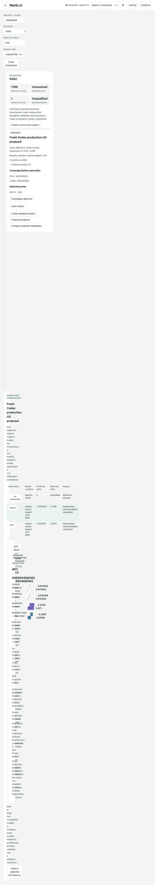

# Production workbench qualification

Registered 2026-10-14 before formal performance and end-to-end qualification.

The release changes NumiLab presentation, local discovery and shared-state handling. It adds no model training, scientific scoring or biological promotion. NumiVivo remains the scientific owner. Historical sealed adapters and records remain unchanged.

## Registered performance targets

On the actual Apple Mac and admitted Replogle–Nadig engineering cohort (30,144 admitted cells, metadata-defined subset), measure cold browser/service and warm requests separately:

| Interaction | Target |
|---|---|
| Visible input feedback | 100 ms |
| Usable dataset metadata after workspace readiness | 2 s |
| First requested gene | 5 s |
| Cached selection/readout update | 250 ms |
| Browser expression transfer | Requested gene ≤128 values per group; no whole-cohort expression |

Report hardware, dataset fingerprints, cache state, response bytes, observations and p50/p95. Small runs do not establish general hardware performance. Cold initialization includes native scientific owner import; dataset metadata is timed separately after service readiness. Missed targets remain findings.

## Required integrity checks

Acknowledged human/agent edits, stale conflict retention, unsupported conditions/genes/models, measured-only execution blocking, reserved observation protection, explicit reveal, cancellation/recovery, missing dependencies, source-bound viewer preparation, exact frozen native replay, consistent snapshot and relocated restore. UI preferences do not increment scientific revisions. Unknown presentations never fall back to another model.

Codex pointer and keyboard qualification is separate from automated browser regressions. Safari is unsupported until separately qualified. Physical touch and uncoached researcher usability remain pending.

## Runtime and frontend

The installed laboratory runs Python and packaged static ES modules. Node and pinned TypeScript 5.9.3 are build dependencies only. Build with `npm ci --ignore-scripts && npm run build` in `python/metalrobo/wet_lab`. The acknowledged service client owns cancellation, stale-response checks and a bounded 32-entry readout cache. Layout preferences live in a separate browser storage key. The current workbench replaces the old default interface; archived sealed artifacts retain their original owners.

Qualification results and support matrix are appended when execution completes.

## Delivered release and support matrix

Three published increments retain the existing Python service, shared interaction owner and NumiVivo scientific operations. The default interface is now the packaged TypeScript workbench. The installed runtime is content-addressed under `~/.numi/runtime/wet-lab`; `numi wet-lab open` discovers a ready retained laboratory, recovers a stale service record and supplies a fresh private session. The production laboratory requires Python/native scientific dependencies, but no Node process or disposable source checkout.

| Capability | Qualification |
|---|---|
| Real cellular cohort exploration | Actual Codex pointer/keyboard; 30,144 admitted cells, bounded single-gene values, four contexts |
| Frozen cellular prediction | Two-arm FOS/JUNB objective, native weights bound on cards, seal followed by a separate explicit reveal |
| Model / condition comparisons | Shared controls and owner diagnostics implemented; this qualification used one compatible frozen cellular model and K562 condition. Multi-model execution was not established by fabricating another artifact |
| Shared human/Codex editing | Fresh desktop session preserved the human objective and candidates; stale revisions rejected |
| Interruption/cancellation | Actual native replay worker stopped/cancelled; explicit recovery completed exactly |
| Immutable cellular history | Existing revealed and still-sealed cellular records replayed on copies without changing any files or opening new observations |
| Portable restoration | Export imported into another lab while original qualification directory was unavailable; 56 sealed files unchanged; no external dependencies; no automatic worker restart |
| Fresh-session restoration | Second fresh desktop session discovered the restored lab and completed exact replay; original directory remained unavailable during that execution |
| Spatial presentation | Indexed source geometry renderer and bounded owner fields implemented; real retained spatial execution/visual qualification **blocked by missing verified chip1/chip2 H5AD sources** |
| Spatial historical integrity | 22 sealed files verified; full observation comparison/replay remains blocked by those sources |
| Native viewer handoff | 150 accessible measured cells, one gene, ≤128 per group; no reserved cells or fabricated coordinates. Prepared artifact only; native rendering was not confirmed |
| Appearance/accessibility | Actual Codex light/dark operation and keyboard commands; automated 1440/1024/768 px layouts, labelled controls, visible keyboard focus, text contrast ≥6.05:1, reduced motion, no horizontal overflow or browser errors |
| Safari | Unsupported; not executed |
| Physical touch / uncoached researcher usability | Pending, separately scoped |

The corrected spatial artifact remains discoverable in the retained laboratory. Missing sources are reported as `UNAVAILABLE`; the application does not substitute a cellular artifact, old spatial model or synthesized geometry. The original laboratory remains available through `numi wet-lab open --name cellular-cohort-v04`. The restored qualified cellular laboratory is `production-ux-restored`.

Qualification used the actual Codex in-app browser on a MacBook Air Mac16,12, Apple M4 (10 cores), 24 GB, macOS 26.6 build 25G5028f. Command/search, acknowledged editing, supported correction, native execution, explicit reveal and gene-level failure inspection were operated through the shared interface. A CLI fresh-session attempt failed because the configured CLI model was unsupported by the signed-in account; the successful fresh sessions used the desktop app. App-level Computer Use control of Codex was denied; browser pointer and native keyboard input were available. Automated Chromium checks supplement those interactions and are not researcher usability evidence.

## Measured performance

Dataset fingerprint: `75145e15e00f9e1a454c304fa965497cbc3b07880106f720a35a672680b10e38`. The final recorded installed-browser run measured metadata in **195.2 ms**, first requested real-cohort gene in **343.6 ms**, cached gene updates **p50 3.5 / p95 3.58 ms** (five observations), and input feedback **p50 6.80 / p95 13.86 ms** (38 trusted events). Recorded payloads were 36,757 bytes for assay metadata, 11,478 bytes for a candidate page and 6,985–7,064 bytes for individual measured-gene pages. Shared proposal metadata reached 190,299 bytes with two experiment cards; it did not contain whole-cohort expression.

The frozen release service process started in 1,279.4 ms; an earlier recorded process started in 992.5 ms. Browser/service processes were fresh for cold runs; OS/filesystem caches were not flushed and prior data import was possible. Warm results use the bounded browser session cache. All registered thresholds were met in these sampled runs, subject to their measurement scopes: trusted-event-to-next-animation-frame is a feedback proxy, not physical display latency; readout timing ends after DOM construction. These small samples on one Mac do not establish general hardware performance.

The early instrumentation labelled native normalized units as `raw_counts`; that telemetry defect was repaired and its prior observation retained. Actual native owner values stayed `log1p(CPM)`. A cached response now cancels any obsolete request on its channel; both cache and telemetry storage are bounded. Rendered distributions include their actual bounded values in shared comparison scales rather than clipping them to population means.

## Reproduction and evidence

Run local Python discovery for `numi_wet_lab_*test.py` and `numi_*view*test.py`, then `node --test tests/numi_wet_lab_client_test.mjs`. Build the packaged assets with the command above. Execute `tests/numi_wet_lab_browser_regression.js` using the installed Playwright CLI `run-code --filename` against a ready local lab; this runner supplies its `page` argument and needs no production Node process. Reinstall the runtime with `tools/install_wet_lab_runtime.py --python PATH_TO_QUALIFIED_PYTHON`; reinstall/check the existing plugin and start a fresh Codex session.

The bounded evidence files in [qualification/virtual-wet-lab-production-ux-20261014](qualification/virtual-wet-lab-production-ux-20261014) bind the frozen model, immutable records, snapshot/export hashes, restored operation and timing scopes. Snapshot `8ba920348c0b4149a2df821950e2a514` and its exported archive remain in the durable laboratory storage. Relocation is recorded separately; sealed registrations were not rewritten. The original qualification directory was made available again only after the fresh-session recovery passed.

No learned model was trained or promoted. The frozen cellular artifact exposes population means, not individual response distributions. Its failed biological predictions remain visible alongside matched baselines and signed residuals. Source identity, unresolved biological units, reserved access, insufficient support and unqualified recommendations remain distinct from software execution success.

