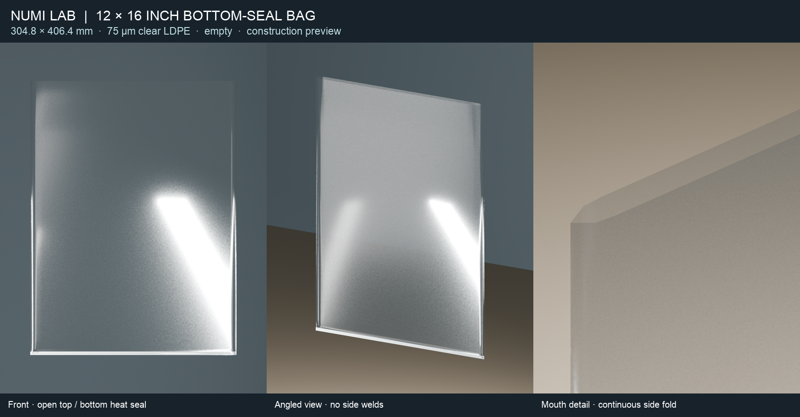

# 12 × 16 inch bottom-seal plastic bag



New empty bag construction authored and exported by the native Numi film-scene owner on macmini. This artifact contains the construction and product views. No dynamics run has been performed for this variant.

## Shape and material

- Finished lay-flat width **12 inches / 304.8 mm**; overall height **16 inches / 406.4 mm**, including the bottom seal.
- One continuous film tube with two side folds, **one heat seal across the bottom**, and one open mouth. No side heat seals, gussets, handles, zipper or flap.
- Same exploratory clear LDPE material and presentation shader as the approved bag: **75 µm**, density **923 kg/m³**, Young's modulus **100 MPa**, Poisson ratio **0.45**, strain viscosity time **0.0004 s**, bending viscosity time **0.010 s**.
- Native slightly opened reference mesh mass **17.1757 g**. Nominal perfectly flat two-panel film mass is **17.1499 g**; the 0.1506% difference comes from the opened geometric reference area. These are assumed material properties, not measured bag calibration.
- 2,721 dynamic nodes, 5,376 triangles, 10,782 membrane springs and 8,000 bending hinges. No fixed nodes or coins.

## What changes in the native construction

The front and back arrays are two coordinate charts of a continuous tube. Shared side vertices **and 84 side-fold bending hinges** carry the film through the side folds. Side folds use a pi rest dihedral to represent the manufactured lay-flat crease. They are not side welds or free hinges. Only 32 bottom edges are classified as a heat seal. There is one 64-edge open mouth loop; all other triangle edges have two incident faces. The mesh has Euler characteristic one and no degenerate triangles.

The bottom heat seal is currently an **ideal shared line joint**. The visible 5 mm flat heat-pressed band is presentation geometry; a finite-width thermal weld, peel failure and weld rupture have not been modeled. Side crease plasticity is not calibrated. The approved Metal kernels remain byte-identical; topology, dimensions, crease rest angles and the initial construction are the changes.

A native incidence check caught an inherited corner diagonal that duplicated a triangle between the front/back charts. The bottom-right cell diagonal is flipped in this variant so every closed mesh edge has exactly two incident faces. The rejected construction source and failure log are retained under `evidence/rejected_initial_topology`. The earlier approved examples are unchanged.

## Reproduce the construction

On an Apple Silicon Mac with Xcode command-line tools:

```sh
zsh build_only.sh
./build/numi_bottom_seal_bag --export-construction construction
```

The native export includes actual indexed vertices, triangles, hinges, mass, chart arrays, and explicit bottom-seal / continuous-side / mouth edge sets. Internal construction invariants are checked before export. `initial_state.json` is generated from that exact native construction. This is a new topology; old bag checkpoints and robot grasp paths must not be reused without authoring paths for this bag.

To reproduce the saved views with Blender:

```sh
blender -b --python-exit-code 1 --python runtime/render_construction.py -- construction/construction.json views
```

The inherited renderer supplies the same film shader and presents exact native vertices. It supplies no dynamics. `evidence/construction_record.json` binds source, binary, Metal library and exported mesh hashes. Material calibration, crease calibration, air drag and motion validation remain open.
