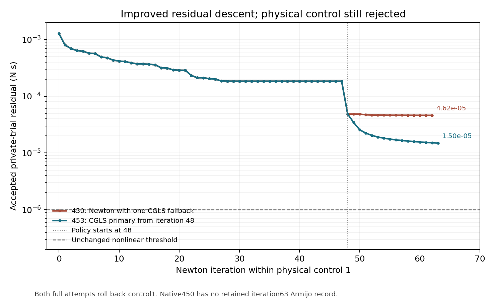

# Source145: exact state joins and complete-phase convergence support

Source145 adds bounded Newton-state capture, an opt-in CGLS primary-selection policy and a distinct post-release relaxation phase to the existing native driver. The shipping-box recipe, physical FEM operator and production acceptance tolerances remain unchanged. This milestone does **not** complete the coupon solve or qualify a folded/crushed box.

## Measured results

- Native453/455: switching to CGLS at Newton48 accepts all16 remaining private full updates and reduces the last tested residual to `1.49501593e-5 N s`. Both attempts still fail the final control1 certificate and roll back. One physical control is accepted; private Newton updates are not physical steps.
- Native454: primary-policy disabled preserves native450's full attempted history. Native455: the state observer preserves native453's full attempted history.
- Native459: the new post-release count at its default zero preserves native455's complete attempted history:35 output files,112 Armijo records,4096 true-residual records,64 CGLS records, exact binary state/correction payloads. Only the declared zero field and paths differ. Both attempts fail; this is not a complete coupon.
- Native458: primary CGLS from Newton0 is worse, ending at `5.54202161e-5 N s`. The failed experiment and all diagnostics are retained. Its requested post-release phase was never reached.

## Exact state and derivative scope

The default-off `NM_FEM_BASE_CGLS_STATE_CAPTURE=1` observer captures24 arrays at the selected Newton before CGLS modifies its private direction. It includes exact accepted/candidate nodes and tets, masses, constraints, accepted history, literal candidate-history arena, materials, scalar programs, parameters, correction, RHS and tangent cache. The payload is4,327,464 bytes at the retained two-environment882-node/1920-tet state. The corrected reader verifies the actual96-byte tetrahedron ABI; the earlier112-byte reader failure is preserved.

Native455's state joins the original419 captured center exactly for nodes, history, cached tangents, parameters, correction and RHS. Tetrahedron differences are signed-zero representations only. Current-Newton projected history is **unavailable** in the candidate-history arena at this callback; the manifest says so. That arena must not be described as the current return-map result.

The independent FP64 audit reprojects all paper elements at that exact center. All17,280 nonzero material derivative columns meet the `1e-3` comparison gate; worst paper-column error is `6.135899309e-5`. The full element/frame reconstruction compares23,040 columns with maximum error `3.8592908775e-5`. Full assembled free columns compare with maximum relative error `5.1138629093e-8`, separating exact mass from stiffness.

These are analytic cached-tangent comparisons at one captured center, not fresh native all-column finite differences. The FP64 directional interval study remains separately source-bound. Metal FP32 finite-difference qualification remains inconclusive without a resolved absolute noise floor. Assembly verification records its original NumPy warnings, a warning-free explicit-contraction recheck and an independent scalar-summation review; no nonfinite result was accepted. The inherited report label treating parameter26 as a rate exponent is corrected: it is the complementarity smoothing parameter.

## Driver and convergence commands

`--post-release-relax-steps N` adds a separate accepted `post_release_relaxation` phase after grip release. It defaults to zero, requires positive release steps, and is supported by the end-grip coupon. The left coupon grip remains fixed; this phase is not fixture-free shipping assembly. Shipping uses its separate released-settle stage.

The resolution planner scales every phase's step count under timestep refinement while preserving duration and path. A complete qualification now requires loading, hold, withdrawal, clamped relaxation, release **and** positive post-release relaxation. Prefixes and failed certificates are refused. Slower loading is a separate comparison. Finest-pair force/work/curve/springback and damage-area gates remain unchanged, and decreasing refinement differences are strict.

The immutable commands and predictions are archived with each native case. Examples use the source-bound wrapper, never an unbound probe binary:

- `solver/cgls-primary-after48-control1-453/prediction.json`: primary-after48 experiment.
- `solver/cgls-state-sidecar-observer-455/prediction.json`: read-only state observer.
- `solver/post-release-default-zero-parity-459/prediction.json`: default-zero phase control.

The retained-source packages reconstruct sources143,144,145 and149 from pinned published Git bases plus hashed compressed changed blobs. Complete disk restorations were verified. Build receipts and exact binary hashes remain bound to their original runs.

## Conditioning experiments and remaining gates

Offline right-scaling studies reduce the captured linear residual, but native456/457 mechanical residual replays show worse full-step nonlinear residuals than unscaled CGLS. At64 iterations, unscaled gives `4.83878e-5 N s`; the node-block inverse gives `5.88705e-5 N s`. Some smaller updates improve. These are candidate mechanical residual probes, with no physical transaction, contact or production Armijo certificate.128 iterations are offline only. No conditioning benefit is inferred from a smaller linear residual alone.

| Verdict axis | Current result |
| --- | --- |
| Solver correctness | Captured material/element/assembled analytic comparisons and full attempted-history observer controls pass within their stated scope. Complete nonlinear solve and nonlinear-contact qualification remain open. |
| Numerical convergence | No complete coupon spatial, timestep or slower-loading study. No damage/interface/scoring/assembly/crush convergence. |
| Component calibration | Published-data package and bounded constituent/interface implementations exist; exact kraft/NSSC damage and local starch fracture parameters are not uniquely identified. |
| Analogue validation | Grade, conditioning, fixture and loading-rate transfer limits remain explicit. No new validation claim. |
| Physical assembly in simulation | No completed12-score, wall/lap/end closure and fixture-free settled300×200×200mm box. Shipping contact arenas and memory admission remain open. |
| Crush and impact prediction | No qualified first compression peak, heavy-object masses, gravity crush or drop results. |

The next solver work must retain exact same-generation regional conditioning state, validate both the preconditioner and its transpose, and obtain a complete certified coupon before launching the requested resolution matrix. Damage, debonding, scoring, full assembly and crush/drop must then repeat their own resolution gates. Public-data identifiability limits remain open even after software tests pass.

Storage compactions019/020 preserve sole closed-input recovery archives; keep them. Compactions021/022 removed only duplicate external outputs whose committed compressed copies were fully restored and hash-verified. Restore pointers accompany the retained cases. No source snapshot or native binary was removed.
